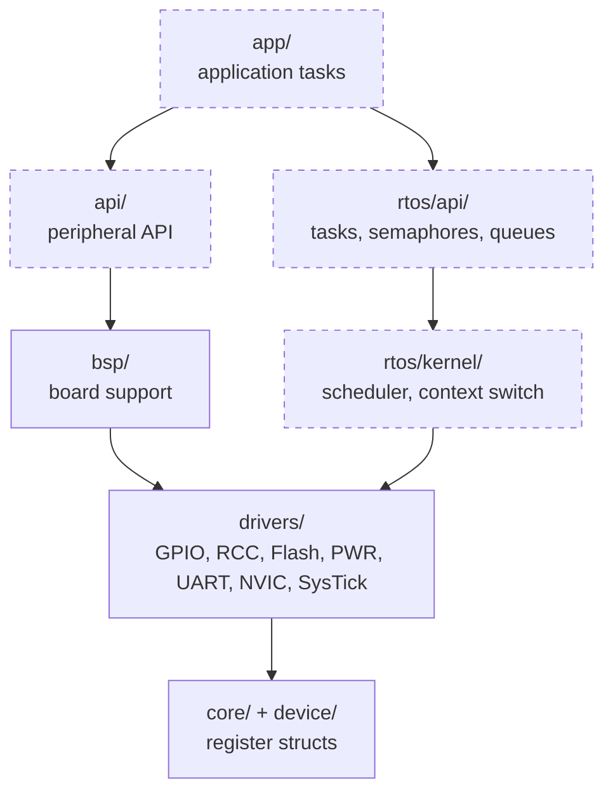
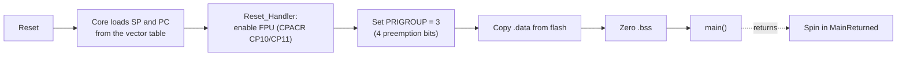
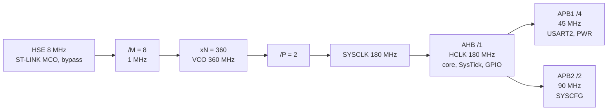

# Architecture

How the code is organised, how the chip boots, and how it is clocked. The
reasons behind the conventions are in [Design notes](DESIGN.md).

## Layers

Each layer includes headers only from itself and the layers below it.
Dashed layers are not implemented yet.



- `api/` is the peripheral-facing layer (for example an LED or a debug
  print), built on `bsp/`'s pin mapping and independent of the RTOS.
- `rtos/api/` is the kernel-facing layer.
- `app/` uses only those two and never reaches into `drivers/` or
  `rtos/kernel/`.

Every `inc/` directory is on the include path, so the build does not enforce
the rule; review does.

## Directory layout

```
core/inc/        Cortex-M4 core registers: MPU, NVIC, SCB/FPU, SysTick
device/inc/      STM32F446 registers: EXTI, Flash, GPIO, IWDG, PWR, RCC,
                 SYSCFG, USART/UART, WWDG
drivers/         Drivers and the DriverStatus_e error contract
bsp/             NUCLEO-F446RE support (180 MHz clock bring-up)
api/, rtos/      Reserved for the peripheral API and the kernel
app/             main()
startup/         Vector table and Reset_Handler
linker/          Memory layout (STM32F446RE.ld)
tests/unit/      Host-side Unity tests, one file per module
tests/unity/     Vendored Unity
tools/           Build checks (awk, sh) and openocd.cfg
docs/            These pages, groups.dox and the Doxygen theme
```

## Boot sequence



- The FPU is enabled before any C runs because every file is built
  hard-float.
- Each handler in the vector table is a weak alias of `Default_Handler`, an
  infinite loop, until a real one is defined. That includes `PendSV_Handler`
  and `SysTick_Handler`, which belong to the future kernel.
- `tools/check_vector_table.awk` checks the table against `IRQn_e` in
  `core/inc/nvic_reg.h`.

## Clock tree

`bspClockInit()` produces this configuration (constants in `bsp/inc/bsp.h`):



This needs regulator scale 1 with over-drive and 5 flash wait states. See
[Clock bring-up order](DESIGN.md#clock-bring-up-order) for the order
RM0390 imposes.

## Memory map

Defined in `linker/STM32F446RE.ld`.

| Region | Base         | Size   | Contents                                  |
| ------ | ------------ | ------ | ----------------------------------------- |
| FLASH  | `0x08000000` | 512 KB | `.isr_vector` first, then code and data   |
| RAM    | `0x20000000` | 128 KB | `.data`, `.bss`, heap and stack reserve   |

- `.data` is stored in flash and copied to RAM at reset.
- The stack starts at the top of RAM.
- The link fails if `.data` + `.bss` leave less than the 512-byte heap plus
  1 KB stack reserve free.

## Board (NUCLEO-F446RE)

| Function         | Pin                 | Peripheral |
| ---------------- | ------------------- | ---------- |
| User LED (LD2)   | PA5                 | GPIOA      |
| User button (B1) | PC13                | GPIOC      |
| ST-LINK VCP      | PA2 (TX), PA3 (RX)  | USART2     |
| HSE input        | MCO from ST-LINK    | 8 MHz      |
