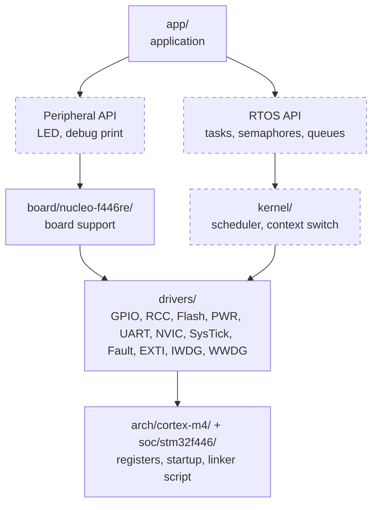
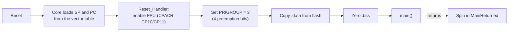
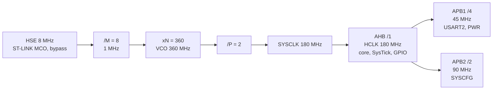

# Architecture

How the code is organised, how the chip boots, and how it is clocked. The
reasons behind the conventions are in [Design notes](DESIGN.md).

## Layers

Each layer includes headers only from itself and the layers below it.
Dashed layers are planned and do not exist yet.



- `arch/cortex-m4/` is the processor core and `soc/stm32f446/` is the chip
  around it. `board/nucleo-f446re/` is what is soldered to it on this board.
- The peripheral API is the application-facing layer for the board (for
  example an LED or a debug print), built on the board's pin mapping and
  independent of the RTOS. The RTOS API is the kernel-facing layer.
- `app/` uses only those two and never reaches into `drivers/` or the kernel.
- A planned layer gets its directory when its code arrives. The kernel is
  expected in `kernel/`, with its Cortex-M4 context switch in
  `arch/cortex-m4/src/`.

Every `inc/` directory is on the include path, so the build does not enforce
the rule; review does.

## Directory layout

```
arch/cortex-m4/inc/    Cortex-M4 core registers: MPU, NVIC, SCB/FPU, SysTick
soc/stm32f446/inc/     STM32F446 registers: DBGMCU, EXTI, Flash, GPIO, IWDG,
                       PWR, RCC, SYSCFG, USART/UART, WWDG
soc/stm32f446/         Vector table and Reset_Handler (startup_stm32f446re.s),
                       memory layout (STM32F446RE.ld)
drivers/               Drivers and the DriverStatus_e error contract
board/nucleo-f446re/   Board support (180 MHz clock bring-up), openocd.cfg
app/                   main()
tests/unit/            Host-side Unity tests by layer (arch/, soc/, drivers/,
                       board/), and the runner
tests/target/          On-target smoke test, a second image (make smoke)
third_party/           Vendored code: Unity and doxygen-awesome-css
scripts/               Build and release checks (awk, sh); ci/ holds the CI
                       summary script and the hash-locked Python tools
docs/                  These pages, the Doxyfile, groups.dox, the site theme
```

## Boot sequence



- The FPU is enabled before any C runs because every file is built
  hard-float.
- HardFault, MemManage, BusFault and UsageFault are weak aliases of
  `Fault_Handler`. It records the cause and the stacked registers in
  `faultRecord` (`drivers/inc/fault.h`) and spins; halt and run
  `p/x faultRecord` in GDB.
- Every other handler is a weak alias of `Default_Handler`, an infinite
  loop, until a real one is defined. That includes `PendSV_Handler` and
  `SysTick_Handler`, which belong to the future kernel.
- `scripts/check_vector_table.awk` checks the table against `IRQn_e` in
  `arch/cortex-m4/inc/nvic_reg.h`.

## Clock tree

`bspClockInit()` produces this configuration (constants in
`board/nucleo-f446re/inc/bsp.h`):



This needs regulator scale 1 with over-drive and 5 flash wait states. See
[Clock bring-up order](DESIGN.md#clock-bring-up-order) for the order
RM0390 imposes.

## Memory map

Defined in `soc/stm32f446/STM32F446RE.ld`.

| Region | Base         | Size   | Contents                                  |
| ------ | ------------ | ------ | ----------------------------------------- |
| FLASH  | `0x08000000` | 512 KB | `.isr_vector` first, then code and data   |
| RAM    | `0x20000000` | 128 KB | `.data`, `.bss`, heap and stack reserve   |

- `.data` is stored in flash and copied to RAM at reset.
- The stack starts at the top of RAM.
- The link fails if `.data` + `.bss` leave less than the 512-byte heap plus
  1 KB stack reserve free.
- The link also fails on any section the script does not name
  (`--orphan-handling=error`), such as `.init_array` from a C constructor or
  `.tbss` from `_Thread_local`, since nothing at startup would initialise
  either.

## Board (NUCLEO-F446RE)

| Function         | Pin                 | Peripheral |
| ---------------- | ------------------- | ---------- |
| User LED (LD2)   | PA5                 | GPIOA      |
| User button (B1) | PC13                | GPIOC      |
| ST-LINK VCP      | PA2 (TX), PA3 (RX)  | USART2     |
| HSE input        | MCO from ST-LINK    | 8 MHz      |
